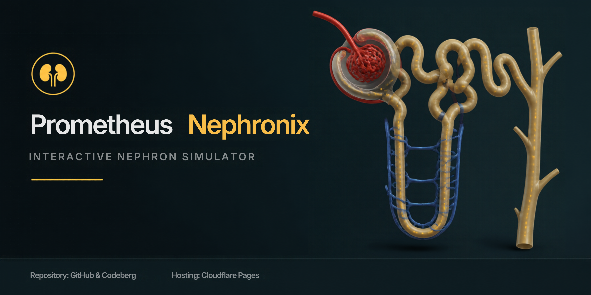
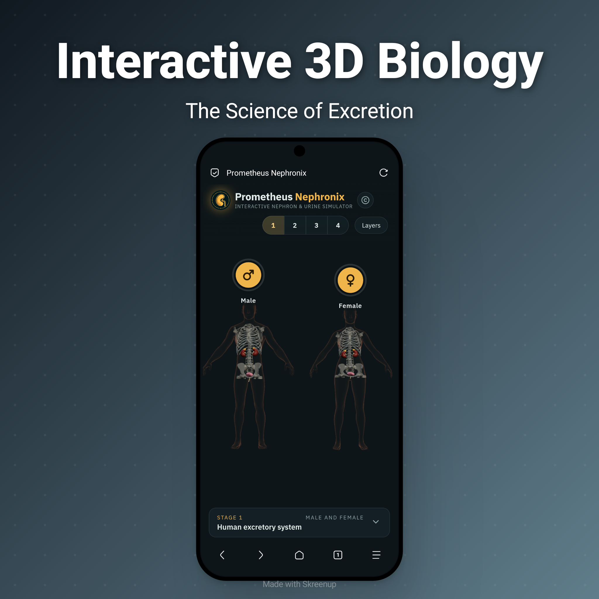
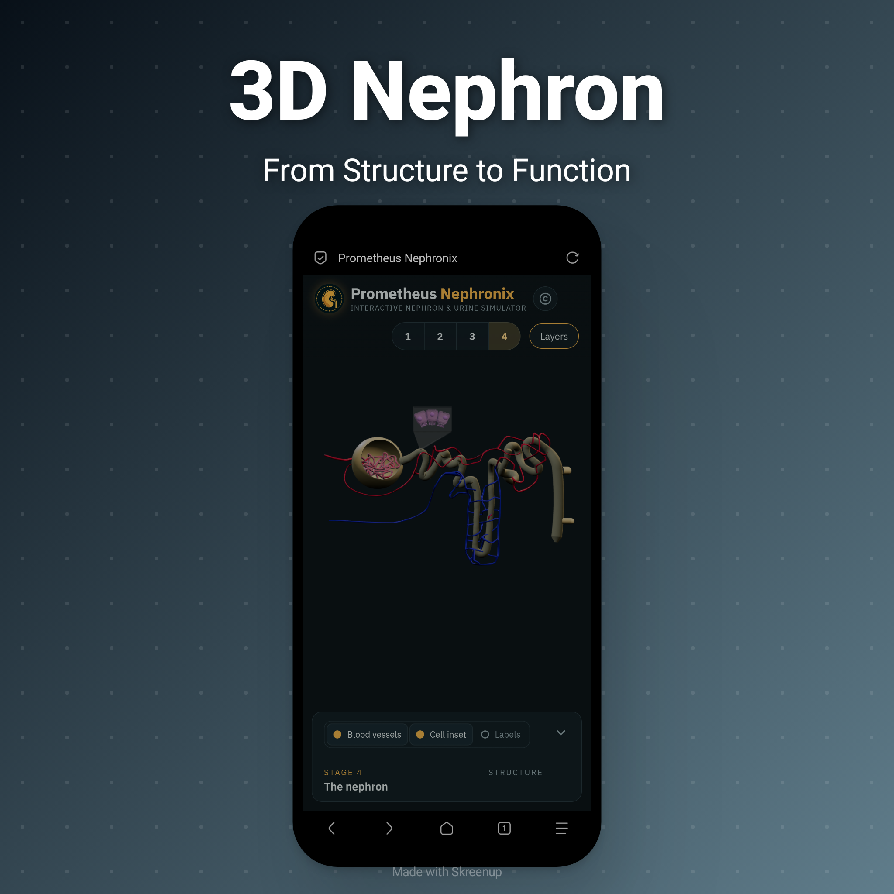

  

<h1 align="center">Prometheus Nephronix</h1>

  <strong>Interactive Nephron &amp; Urine Formation Simulator</strong>

  Explore the human excretory system through interactive 3D anatomy, nephron visualisation and dynamic physiological simulations.

  <a href="https://prometheus-nephronix.stark-kodex.workers.dev/">
    <strong>✦ Explore the Simulator</strong>
  </a>

---

  <em>Project Dedicated to Lord Vishnu</em>

---

🔸 **Features**

- Excretory System: Interactive 3D male and female urinary anatomy.
- Kidney Anatomy: Explore internal structures and blood supply.
- 3D Nephron: Examine nephron segments and associated blood vessels.
- Urine Formation: Visualise filtration, reabsorption and secretion through particle animations.
- Countercurrent Mechanism: Explore the loop of Henle, vasa recta and medullary osmotic gradient.
- Physiological Regulation: Interactive simulations of ADH, RAAS and ANF.

---

🔸 **Screenshots**

<table width="100%" cellpadding="12" cellspacing="0">
  <tr>
    <td width="50%" valign="top" align="center">
      <strong>01 · Human Excretory System</strong>
        
      Explore male and female 3D anatomical models of the human urinary system.
        
      
    </td>
    <td width="50%" valign="top" align="center">
      <strong>02 · Kidney Anatomy &amp; Blood Supply</strong>
        
      Explore the kidney's internal architecture and vascular organisation.
        
      
    </td>
  </tr>
  <tr>
    <td width="50%" valign="top" align="center">
      <strong>03 · 3D Nephron</strong>
        
      Explore nephron architecture and its associated blood vessels.
        
      
    </td>
    <td width="50%" valign="top" align="center">
      <strong>04 · Selective Reabsorption</strong>
        
      Visualise glucose transport and reabsorption across proximal tubule epithelial cells.
        
      
    </td>
  </tr>
  <tr>
    <td width="50%" valign="top" align="center">
      <strong>05 · Countercurrent Mechanism</strong>
        
      Explore the medullary osmotic gradient and the mechanism of urine concentration.
        
      
    </td>
    <td width="50%" valign="top" align="center">
      <strong>06 · Countercurrent Visualisation</strong>
        
      Explore hormonal regulation and ADH-mediated water conservation through interactive simulation.
        
      
    </td>
  </tr>
</table>

---

🔸 **Technology Stack**

Technology| Purpose
HTML5| Application structure
CSS3| Interface design and styling
JavaScript| Application logic and interactions
Three.js| Interactive 3D rendering
3D Models| Anatomical visualisation
Animation| Physiological processes and particle simulation
Cloudflare Pages| Hosting and deployment

---

🧩 **3D Model Credits**

The following Sketchfab models have been adapted for use in Prometheus Nephronix.

Male & Female Body

- Creator: FormForge3D
- "Sketchfab Model" (https://sketchfab.com/3d-models/male-female-base-mesh-pack-ec3041da6a214c1c995f3d47dc7d04c1)
- Licence: CC BY 4.0

Urinary Tract

- Creator: E-learning UMCG
- "Sketchfab Model" (https://sketchfab.com/3d-models/urinary-tract-822b2eeb033f42f6a8e0e141287bf34d)
- Licence: CC BY-NC-SA 4.0

Kidney — Longitudinal Section

- Creator: thunderpig
- "Sketchfab Model" (https://sketchfab.com/3d-models/kidney-cross-section-b59cc02d4e964af7a2c1fcb0001919d8)
- Licence: CC BY 4.0

Kidney Blood Vessels

- Creator: payoman
- "Sketchfab Model" (https://sketchfab.com/3d-models/kidney-337f06a149e24f05a9d639b161f8f3e9)
- Licence: CC BY 4.0

Nephron

- Creator: iqcenter
- "Sketchfab Model" (https://sketchfab.com/3d-models/nephron-898146d60a0741c6ac9910210e4eac20)
- Licence: CC BY 4.0

---

🔸 **License**

Source Code: "MIT License" (LICENSE).

Third-party 3D Assets: Each model retains its respective licence, as specified above. The urinary tract model is distributed under CC BY-NC-SA 4.0 and is subject to its non-commercial restriction.
