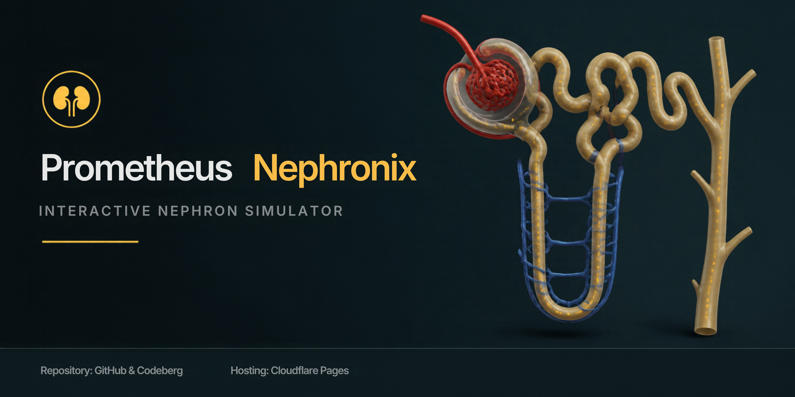

  

<h1 align="center">🫘 Prometheus Nephronix</h1>

<em>Interactive Nephron &amp; Urine Formation Simulator</em>

<a href="https://prometheus-nephronix.stark-kodex.workers.dev/"><strong>Explore the Simulator →</strong></a>

  <a href="#-about">About</a> ·
  <a href="#-screenshots">Screenshots</a> ·
  <a href="#-four-stages">Stages</a> ·
  <a href="#-urine-formation-tour">Urine formation</a> ·
  <a href="#-regulation">Regulation</a> ·
  <a href="#-controls">Controls</a> ·
  <a href="#-concepts-covered">Concepts</a> ·
  <a href="#-technology">Technology</a> ·
  <a href="#-3d-model-credits">Credits</a> ·
  <a href="#-license">License</a>

---

<em>Project dedicated to Lord Vishnu</em>

---

## 📖 About

An interactive 3D simulator of the human excretory system, from the whole body down to a single nephron. Students can:

- **follow the path urine takes** through the male and female body
- **look inside the kidney** and trace its blood supply and drainage
- **watch urine form**, step by step, as colour-coded particles move through the nephron
- **change body fluid or blood pressure** and see how ADH, renin–angiotensin and ANF respond

The content follows NCERT Class 11, *Excretory Products and Their Elimination*. Built for classroom smart panels; it works on laptops and phones too.

---

## 📸 Screenshots

<table width="100%">
  <tr>
    <td width="50%" align="center">
      
       <b>Stage 1 · Excretory system</b>
    </td>
    <td width="50%" align="center">
      
       <b>Stage 2 · Kidney L.S.</b>
    </td>
  </tr>
  <tr>
    <td width="50%" align="center">
      
       <b>Stage 4 · Nephron structure</b>
    </td>
    <td width="50%" align="center">
      
       <b>Stage 4 · Selective reabsorption in the PCT</b>
    </td>
  </tr>
  <tr>
    <td colspan="2" align="center">
      
       <b>Stage 4 · Counter-current mechanism &amp; ADH regulation</b>
    </td>
  </tr>
</table>

---

## 🧭 Four Stages

Four numbered buttons at the top move between stages.

| Stage | Title | What you see |
|:-:|:--|:--|
| **1** | **Excretory system** | Male and female bodies side by side. Hold **♂** or **♀** for 5 seconds to explore one, then follow the path urine takes: kidneys, ureters, bladder and urethra. Turn on **Skeleton** to see the vertebral levels of the kidneys. |
| **2** | **Kidney L.S.** | A longitudinal section of the kidney with numbered dots: capsule, cortex, medullary pyramid, renal column, papilla, calyces, renal pelvis, hilum, ureter, renal artery and vein. |
| **3** | **Vessels & drainage** | Two routes through the kidney: blood in through the renal artery and out through the renal vein, and urine out from the pyramids through the calyces, renal pelvis and ureter. The animated **Flow** layer shows blood moving through the vessels down to the interlobar level. |
| **4** | **Nephron & urine** | A 3D juxtamedullary nephron with its blood vessels, in three tabs: **Structure**, **Urine formation** and **Regulation**. |

In every stage, tap a part or a numbered dot to read about it.

---

## 🧪 Urine Formation Tour

In Stage 4, the **Urine formation** tab runs a seven-step tour in NCERT wording. Colour-coded particles (water, Na⁺, K⁺, Cl⁻, HCO₃⁻, glucose, urea and blood cells) move through the nephron as each step is explained.

| Step | Part | What happens |
|:-:|:--|:--|
| 1 | Bowman's capsule | **Glomerular filtration**: blood pressure filters the blood. Proteins and blood cells are too large to pass. |
| 2 | PCT | **Most reabsorption**: nearly all glucose and amino acids, and most electrolytes and water |
| 3 | Descending limb | **Water out** into the hypertonic medulla |
| 4 | Ascending limb | **Salts out**, leaving the filtrate dilute |
| 5 | Henle's loop and vasa recta | **Counter-current mechanism** builds the gradient from 300 to about 1200 mOsmol L⁻¹ |
| 6 | DCT | **Fine adjustment** of Na⁺, water, H⁺ and K⁺ |
| 7 | Collecting duct | **Concentrating the urine** as water is drawn out |

In the **Structure** tab, tap the magnified PCT cells to see **reabsorption across the brush-border epithelium**.

---

## 🎚️ Regulation

The **Regulation** tab has two sliders. Move them and watch the particles, hormone levels and urine change.

| Sub-tab | Slider | What it shows |
|:--|:--|:--|
| **ADH** | **Body fluid**, from fluid loss to excess water | Osmoreceptors, ADH release, water reabsorbed in the DCT and collecting duct, urine volume and concentration, and diabetes insipidus when ADH is almost absent |
| **Renin–angiotensin & ANF** | **Glomerular blood pressure / blood flow** | JG cells and renin, angiotensin II, aldosterone, and ANF acting as a check, with the effect on GFR and Na⁺ reabsorption |

---

## 🎮 Controls

| Control | What it does |
|:--|:--|
| Drag | Rotate the 3D model |
| Pinch or scroll | Zoom |
| Tap a part or dot | Open its info card |
| **1 · 2 · 3 · 4** | Move between stages |
| **Layers** | Show or hide: Body, Skeleton, Adrenals, Arteries, Veins, Urine route, Flow, Blood vessels, Cell inset and Labels (the choices change with the stage) |
| **Front · Back · Side · Reset** | Change the viewpoint |
| ⏸ / ▶ | Pause or play the animation |
| © | Opens the credits to the 3D model creators |

---

## 🌱 Concepts Covered

| Area | Concepts |
|:--|:--|
| Excretory system | Kidneys, ureters, bladder and urethra · Male and female differences · Ureotelism |
| Kidney | Cortex, medulla, pyramids and columns · Calyces, pelvis and ureter · Blood supply and drainage |
| Nephron | Malpighian corpuscle · PCT, Henle's loop, DCT and collecting duct · Juxtamedullary nephron · Vasa recta |
| Urine formation | Ultrafiltration and GFR · Selective reabsorption · Tubular secretion |
| Concentrating urine | Counter-current mechanism · Medullary osmotic gradient |
| Regulation | ADH · Renin–angiotensin mechanism · Aldosterone · ANF |

---

## 🔬 About the Model

- The reabsorption and secretion rates for each segment are **illustrative numbers** that follow NCERT's description, not measured values.
- The male and female urethras are drawn by the simulator and are not part of the source models.
- The female skeleton is the male skeleton reshaped by the simulator, with a wider, shallower pelvis. Fine details of the pelvis are approximate.
- In the Regulation tab, the JGA marker shows only the JG cells in the afferent arteriole wall, because the DCT runs elsewhere in this model.

---

## 💻 Technology

| Technology | Purpose |
|:--|:--|
| HTML · CSS · JavaScript | Application structure, interface and logic |
| Three.js r160 | 3D rendering |
| 3D models (glTF) | Anatomical visualisation |
| Particle animation | Urine formation and blood flow |
| Cloudflare Pages | Hosting |

Three.js and the fonts (IBM Plex, Roboto) load from a CDN, so the simulator needs an internet connection.

---

## 🧩 3D Model Credits

Sketchfab models, adapted for Prometheus Nephronix. The same credits, with the changes made, appear in the app under ©.

| Asset | Model | Creator | Licence | Changes made |
|:--|:--|:--|:--|:--|
| Male & female body | [Male & Female Base Mesh Pack](https://sketchfab.com/3d-models/male-female-base-mesh-pack-ec3041da6a214c1c995f3d47dc7d04c1) | FormForge3D | CC BY 4.0 | Both figures used; meshes simplified; rendered translucent |
| Urinary tract | [Urinary tract](https://sketchfab.com/3d-models/urinary-tract-822b2eeb033f42f6a8e0e141287bf34d) | E-learning UMCG | **CC BY-NC-SA 4.0** | Reproductive structures removed; skeleton simplified and reshaped for the female figure; materials replaced; fitted into both bodies |
| Kidney, longitudinal section | [Kidney Cross-section](https://sketchfab.com/3d-models/kidney-cross-section-b59cc02d4e964af7a2c1fcb0001919d8) | thunderpig | CC BY 4.0 | Simplified; oriented to face the viewer; mirrored for the left kidney |
| Kidney blood vessels | [Kidney](https://sketchfab.com/3d-models/kidney-337f06a149e24f05a9d639b161f8f3e9) | payoman | CC BY 4.0 | Simplified; a rim vessel inside the capsule removed; flow paths computed for the animation; mirrored for the left kidney |
| Nephron | [Nephron](https://sketchfab.com/3d-models/nephron-898146d60a0741c6ac9910210e4eac20) | iqcenter | CC BY 4.0 | Tubule and Bowman's capsule rebuilt as clean surfaces; collecting-duct branches kept; vessel centre lines traced for the animation |

Licences: [CC BY 4.0](https://creativecommons.org/licenses/by/4.0/) · [CC BY-NC-SA 4.0](https://creativecommons.org/licenses/by-nc-sa/4.0/). Original creators retain ownership of their models.

**Software and fonts:** [three.js](https://threejs.org) (MIT) · [IBM Plex Sans & Mono](https://github.com/IBM/plex) (OFL 1.1) · [Roboto](https://fonts.google.com/specimen/Roboto) (OFL 1.1)

---

## 📜 License

**Source code:** [MIT License](LICENSE).

**3D assets:** each model keeps its own licence, as listed above. The urinary tract model is **CC BY-NC-SA 4.0**, so it is non-commercial, and any adapted version must be shared under the same licence.

---

  <b>Repository</b>: GitHub · Codeberg &nbsp;&nbsp;|&nbsp;&nbsp; <b>Hosting</b>: Cloudflare Pages

